# PCS5917 – IA Adversarial

## Portfólio Individual

**Aluno:** Diego Sousa de Miranda  
**Disciplina:** PCS5917 – IA Adversarial  
**Período:** 3º período de 2026  
**Instituição:** Universidade de São Paulo – Escola Politécnica  
**Professor:** Victor Takashi Hayashi  

## 1. Objetivo do Portfólio

Este portfólio reúne as principais atividades, estudos, experimentos e reflexões desenvolvidos ao longo da disciplina **PCS5917 – IA Adversarial**.

O objetivo é documentar individualmente o processo de aprendizagem sobre:

- notícias e referências científicas sobre IA Adversarial (Aula 1);
- fundamentos de Inteligência Artificial e Segurança (Aula 2);
- aplicação de IA em cibersegurança (Aula 3);
- ataques adversariais contra sistemas de IA (Aulas 4 e 5);
- avaliação de ataques e uso de LLMs como juiz (Aula 6);
- defesas em Large Language Models (Aula 7).

Os experimentos realizados durante as aulas devem ser complementados por registros individuais, notebooks, respectivos resultados e referências bibliográficas (citações).

## 2. Organização do Repositório

**IMPORTANTE**: somente branch main (demais branches serão desconsideradas na correção).
Faça o desenvolvimento incremental com **commits semanais**, pois a evolução durante as semanas também é critério de avaliação.
Organize seu README focando em ser objetivo, com evidências de resultados e citações às referências utilizadas.

```text
.
├── README.md (com registros de resultados)
├── notebooks/ (colocar aqui os notebooks citados no README)
│   ├── aula-02-llm-jailbreaks.ipynb
│   ├── aula-03-asvspoof.ipynb
│   ├── aula-04-nanogcg.ipynb
│   ├── aula-05-pair.ipynb (e/ou cipherchat)
│   ├── aula-06-llm-judge.ipynb
│   └── aula-07-defesas-llm.ipynb
├── images/ (colocar aqui as imagens usadas no README)
│   └── ...
└── outros/
    └── ...
```

## Disclaimer de Uso Ético

Este repositório foi desenvolvido exclusivamente para fins acadêmicos e de pesquisa no contexto da disciplina **PCS5917 – IA Adversarial**.

Alguns experimentos, datasets, prompts, códigos e resultados apresentados podem conter **conteúdo potencialmente malicioso**, incluindo exemplos de jailbreaks, payloads e outras técnicas de ataque. Esses materiais são disponibilizados para fins de estudo, análise, reprodução controlada e compreensão de mecanismos de ataque e defesa.

Os conteúdos devem ser utilizados somente em **ambientes autorizados e controlados**, sem direcionamento a sistemas, modelos, redes, dispositivos ou usuários de terceiros. A reprodução dos experimentos deve respeitar as políticas de uso das ferramentas e os termos das plataformas utilizadas.

O conteúdo deste repositório **não constitui recomendação ou incentivo à realização de atividades maliciosas**. O objetivo é compreender riscos de segurança, desenvolver métodos de avaliação e contribuir para o desenvolvimento de sistemas de Inteligência Artificial mais seguros.

## 3. Resultados obtidos
### Aula 02 – Fundamentos de Segurança e IA

**Cenário**

Nesta atividade avaliou-se a robustez do modelo Kimi-K2 frente a ataques adversariais do tipo *jailbreak*.
O modelo está disponível no HuggingFace e foi utilizando o Inference Provider Novita.
O código gerado para chamada ao LLM está disponível em  [`notebooks/aula-02-llm-jailbreaks.ipynb`](notebooks/aula-02-llm-jailbreaks.ipynb)
Os ataques são baseado nos ataques disponíveis neste [dataset](https://github.com/yjw1029/Self-Reminder-Data/blob/master/data/jailbreak_prompts.csv), sendo empregadas técnicas de personas sem restrições, *roleplay*, ofuscação e cifras, além do uso de outros idiomas (português, russo, fijiano, guarani).
O ambiente de execução utilizado foi o Google Colab.

**Resultados**

No total, **12 dos 101 ataques** tiveram sucesso, uma taxa de sucesso de ataque de **11,9%**. A taxa separada por idioma:
    
| Idioma | Ataques | Sucessos | Taxa de sucesso |
|---|---:|---:|---:|
| Inglês | 75 | 6 | 8,0% |
| Português | 20 | 5 | 25,0% |
| Russo | 4 | 1 | 25,0% |
| Fijiano | 1 | 0 | 0,0% |
| Guarani | 1 | 0 | 0,0% |
| **Total** | **101** | **12** | **11,9%** |

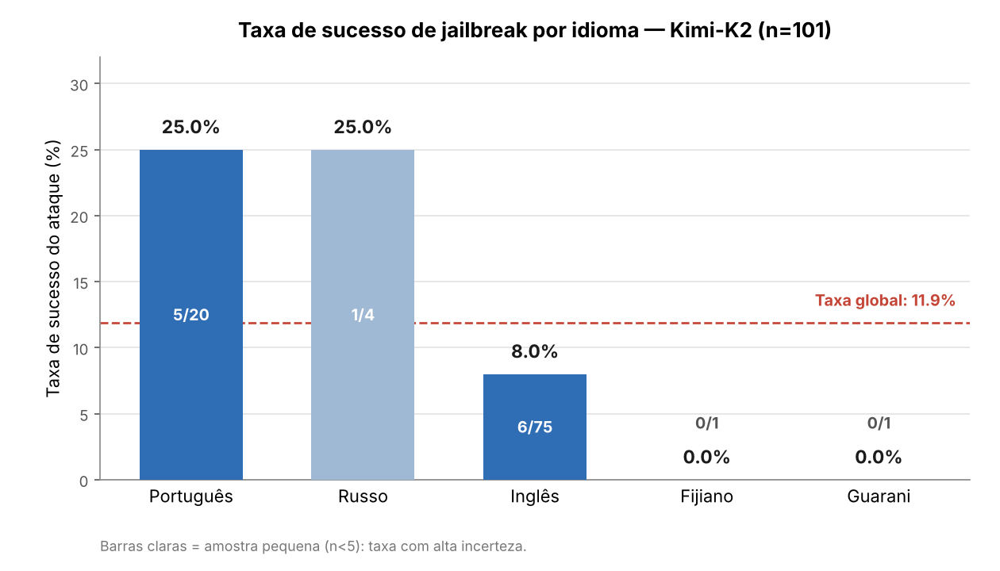

Há uma diferença expressiva entre os idiomas. Os ataques em **inglês**, língua de maior cobertura no alinhamento do modelo, tiveram a **menor** taxa de sucesso (8,0%), ainda que concentrem a maioria das tentativas (75 de 101). Os ataques em idiomas de menor recurso foram proporcionalmente muito mais eficazes: **russo** (25,0%) e **português** (25,0%).

O padrão é consistente com a hipótese de que o alinhamento de segurança dos LLMs é mais frágil fora do inglês, já que as defesas são majoritariamente treinadas e avaliadas nesse idioma.
O conjunto completo encontra-se em [`Outros/Aula 02/prompts_e_respostas.csv`](Outros/aula%2002/prompts_e_respostas.csv).


### Aula 03 – IA para Segurança: Biometria e *Liveness Detection*

**Palestra**

Nesta aula, o professor Dr. Reginaldo Arakaki apresentou uma palestra sobre o uso de IA em biometria e detecção de vivacidade (*liveness detection*), no contexto de um projeto apresentado à Prodesp.
Principais pontos abordados:

- Aplicações de _liveness detection_;
- Detecção de presença viva;
- Preparação da base de dados para treinamento de rede neural e as dificuldades quanto ao uso de conteúdo que podem ferir a LGPD;
- Desafios quanto a taxa de precisão/falso negativo e ataques adversariais.

**Atividade em grupo**

Refere-se a um estudo de caso conforme apresentado na imagem abaixo:

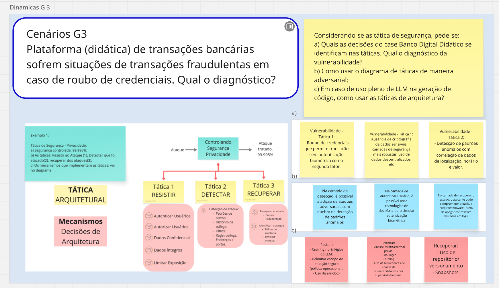


#### Atividade prática — Detecção de Áudio Falso

Cenário:
- **Dataset de referência:** ASVspoof 2024
- **Dataset utilizado:** subconjunto balanceado com 2.000 amostras (bonafide × spoof) do dataset referência. Divisão de 70-30 (treino e teste).
- **Biblioteca de extração de features:** pyAudioAnalysis
- **Notebook:** 

Resultados:

##### A) Análise exploratória

Sinais de áudio bonafide vs spoof:   
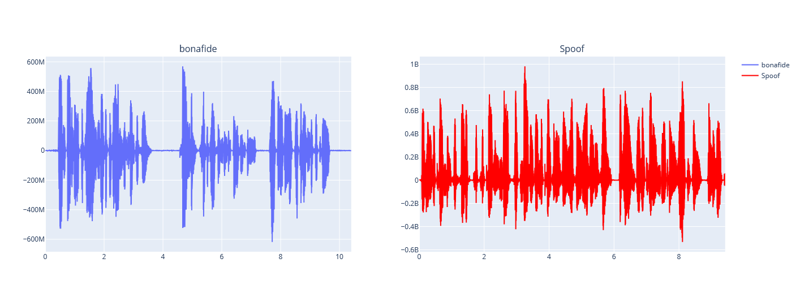

A primeira vista, observa-se pelos sinais de áudio, numa escala temporal, que o audio bonafide há trechos de energia zero, ou seja, silêncio, que não são observados nos áudio spoof.

Para prosseguir com a análise, cada áudio foi reduzido a um vetor de features agregadas, por janelas de médio prazo (0,5 s, passo 0,25 s), a média e o desvio das features de curto prazo do pyAudioAnalysis. Cada frame da janela de curto prazo possui 68 features (34 de curto prazo + 34 deltas). Uma vez que cada janela de médio prazo abrange 20 frames da janelas de curto prazo, calculam-se se duas estatísticas, média e desvio padrão, de cada uma das 68 features, totalizando 136 features por áudio.


Numa análise preliminar por correlação entre as features e a classe alvo, as features **`mfcc_1`, `energy_entropy`, `spectral_centroid`, `spectral_flux`, `chroma_1` e `chroma_7`** apresentaram maior correlação com essa classe. 

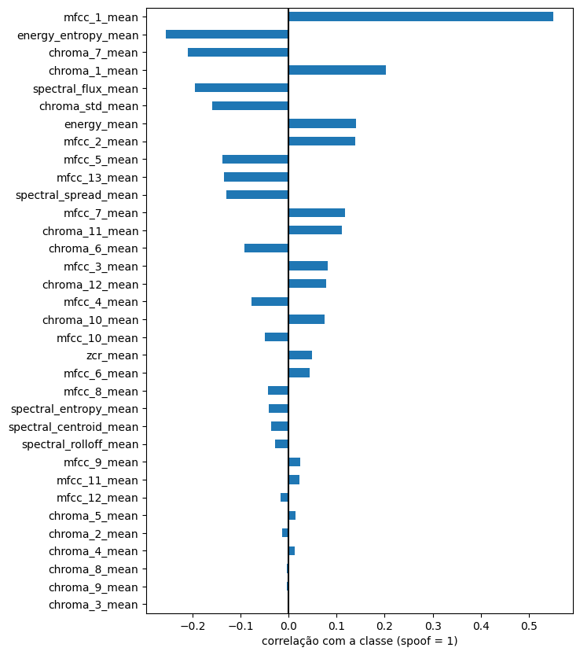

Ainda, a análise sobre essas features (pairplot por pares), observa-se que elas possuem **separabilidade razoável** entre bonafide e spoof, ainda que com sobreposição parcial.   

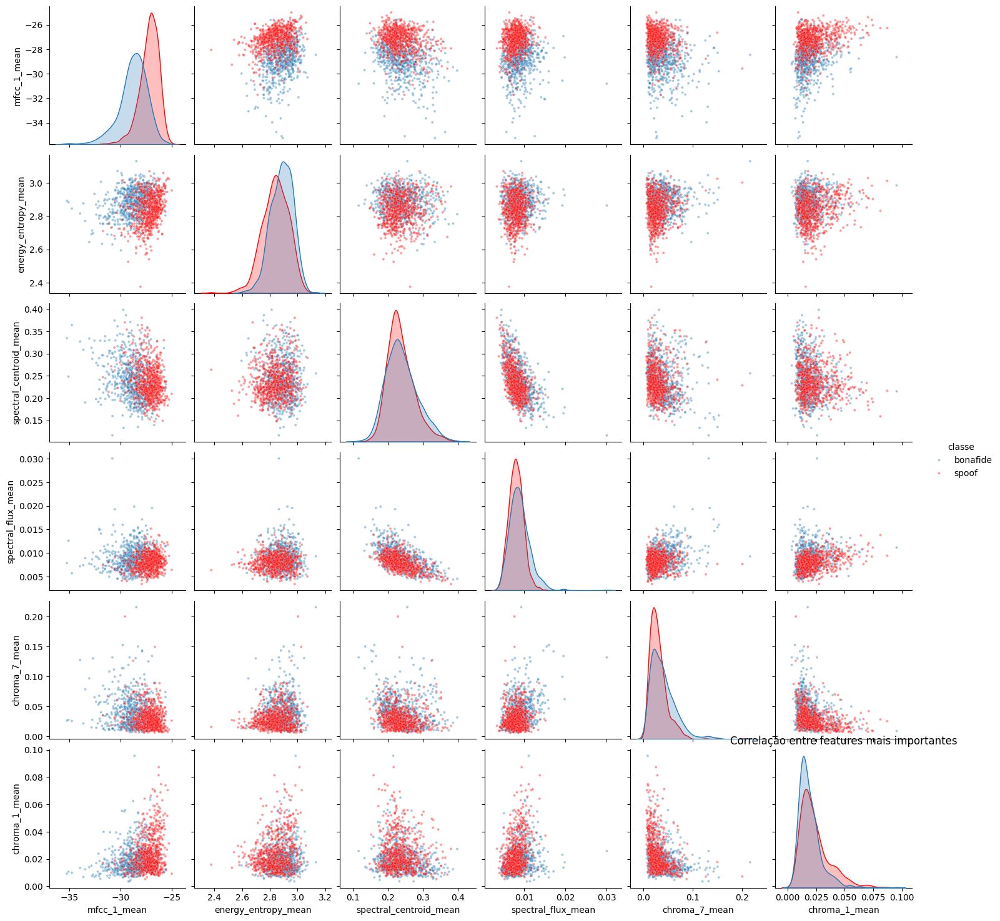

A separabilidade entre ambas classes também foi reproduzida por uma projeção **PCA**, que distingue em 2D os áudios bonafide dos spoof.
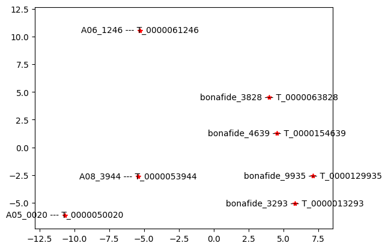

##### B) Treinamento dos classificadores 
 ###### B1 - SVM (kernel linear)
Primeiramente, treinou-se um **SVM linear**, com busca do parâmetro `C` por validação cruzada (interna do pyAudioAnalysis) (critério F1 macro). Melhor resultado:

| C | Precisão bon | Recall bon | F1 bon | Precisão spo | Recall spo | F1 spo | ACC | F1 |
|---|---:|---:|---:|---:|---:|---:|---:|---:|
| **0,500** | **94,6** | **94,7** | **94,7** | **94,6** | **94,6** | **94,6** | **94,6** | **94,6** |

Na avaliação sobre o conjunto de teste (300 bonafide + 300 spoof):

| Classe | Precisão | Recall | F1 |
|---|---:|---:|---:|
| bonafide | 0,921 | 0,933 | 0,927 |
| spoof | 0,932 | 0,920 | 0,926 |

**Acurácia:** 0,927

**Importância das features (pesos do SVM).** Os coeficientes do SVM foram ordenados pelo módulo e exibidos com sinal, sendo positivo puxam para spoof e negativo para bonafide.
Os pesos distribuem-se de forma gradual entre muitas das features sem uma dominante, reflexo da natureza linear do modelo e da correlação entre features.
As de maior peso positivo são `mfcc_1_mean` e a variabilidade de `mfcc_1` e `zcr`, e de menor peso negativo são os desvios dos deltas de MFCCs de ordem alta e do *spectral rolloff*, indicando que a fala real preserva maior variabilidade na dinâmica espectral fina.

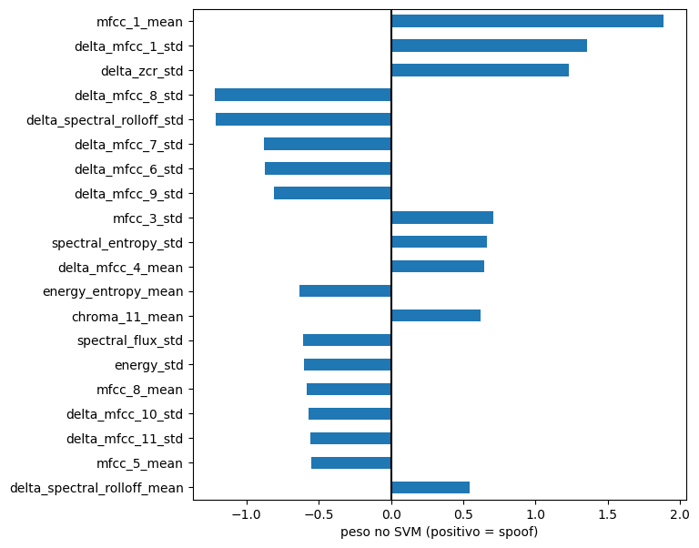

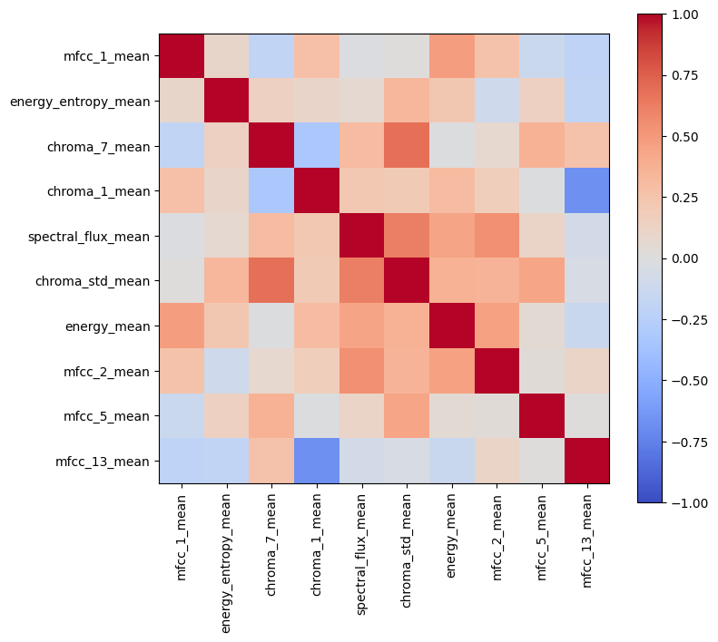

 ###### B2 - GBooting 
O **Gradient Boosting**, foi treinado usando validação cruzada estratificada (k=5 folds) e busca de hiperparâmetros por `GridSearchCV`, obteve o F1 de **0,943** no conjunto de teste de acordo com os parâmetros: `learning_rate ":" 0.1`, `max_depth ":" 5`, `max_iter ":" 300`.   

A importância das features foi avaliada por **permutation importance**

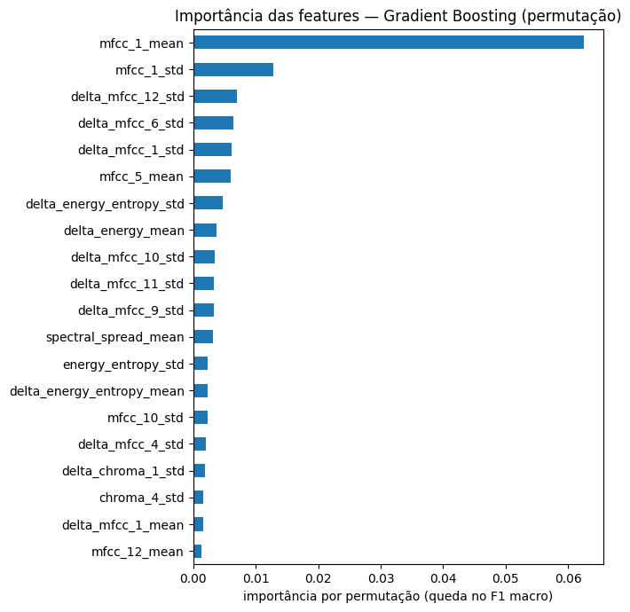

na qual **`mfcc_1_mean`** demonstra-se com grande impacto no desempenho do classificador, cuja remoção derruba o F1 muito acima de qualquer outra feature. As demais features de mais importância também são baseadas em **MFCCs**: `mfcc_1_std` e os desvios dos deltas de MFCCs de ordem mais alta (`delta_mfcc_12_std`, `delta_mfcc_6_std`, `delta_mfcc_1_std`). Isso indica que o modelo se apoia tanto no nível espectral baixo (via `mfcc_1`) quanto em deltas e desvios dos MFCCs de ordem alta.

A sensibilidade de features foi realizada retreinando o classificador com as top-10 features, obteve-se o desempenho abaixo. Esse resultado indica que essas features já pegam a maior parte das características do audio spoof.   
| Classe | Precisão | Recall | F1 |
|---|---:|---:|---:|
| bonafide | 0,92 | 0,87 | 0,89 |
| spoof | 0,88 | 0,92 | 0,90 |

**Acurácia:** 0,90

 ###### RNN-GRU 
A **RNN-GRU**, apesar de modelar a dinâmica temporal, ficou abaixo. Esse comportamento pode ser decorrente do volume limitado de dados, uma vez que modelos baseados em deep learning tendem a exigir grande base de dados de treinamento para superar modelos clássicos.

Diferentemente dos classificadores anteriores, a GRU recebe a sequência completa de frames (68 features por frame) de cada amostra, preservando a ordem temporal do sinal.

**Arquitetura e hiperparâmetros:**

| Parâmetro | Valor |
|---|---|
| Entrada | sequência de frames × 68 features |
| Camada recorrente | GRU — 1 camada, 32 unidades |
| Regularização | Dropout 0,3 |
| Saída | camada linear (1 neurônio) |
| Função de perda | BCEWithLogitsLoss |
| Otimizador | Adam (lr ":" 0,001) |
| Tamanho do batch | 32 |
| Épocas | até 40, com *early stopping* (paciência 5) |
| Divisão de validação | 20% do treino (estratificada) |
| Semente | 42 |

| Classe | Precisão | Recall | F1 |
|---|---:|---:|---:|
| bonafide | 0,879 | 0,897 | 0,888 |
| spoof | 0,895 | 0,877 | 0,886 |

**Acurácia:** 0,887


- **Importância das features.** A importância foi medida por **ablação** (remoção de feature e observação de F1). O maior impacto foi observado em `mfcc_1`, `chroma_1`, `zcr`, `spectral_flux` e `chroma_7`.
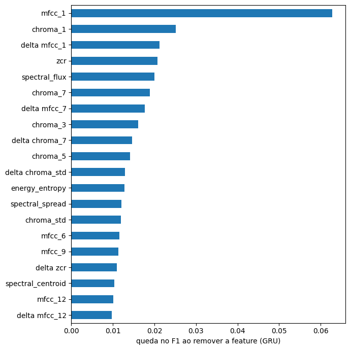

##### C) Análise comparativa

**Comparação dos modelos.** O **Gradient Boosting** obteve o melhor desempenho (F1 0,943), seguido pelo **SVM linear** (F1 0,926), ambos superando a **RNN-GRU** (F1 0,886).

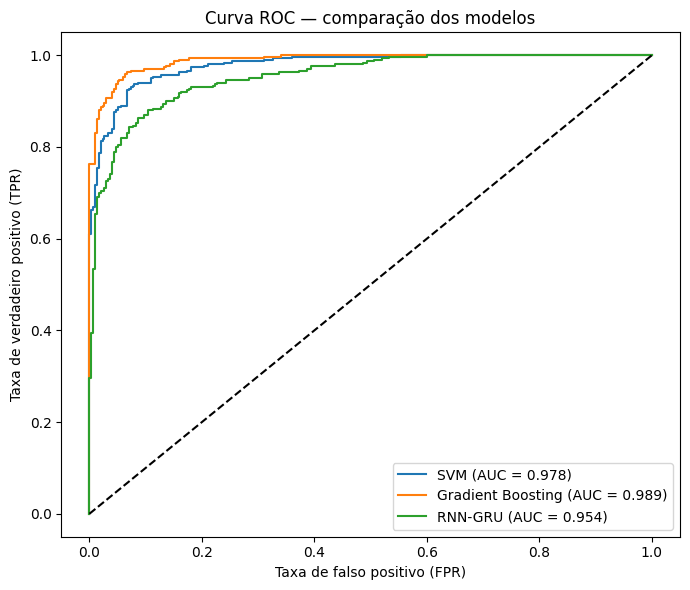

A vantagem dos modelos clássicos é coerente com o cenário atual pois, com dados limitados, as features agregadas já capturam boa parte da informação discriminante, enquanto a RNN-GRU não captura no mesmo nível. Ainda assim, os três concordam na característica mais relevante (`mfcc_1`).  
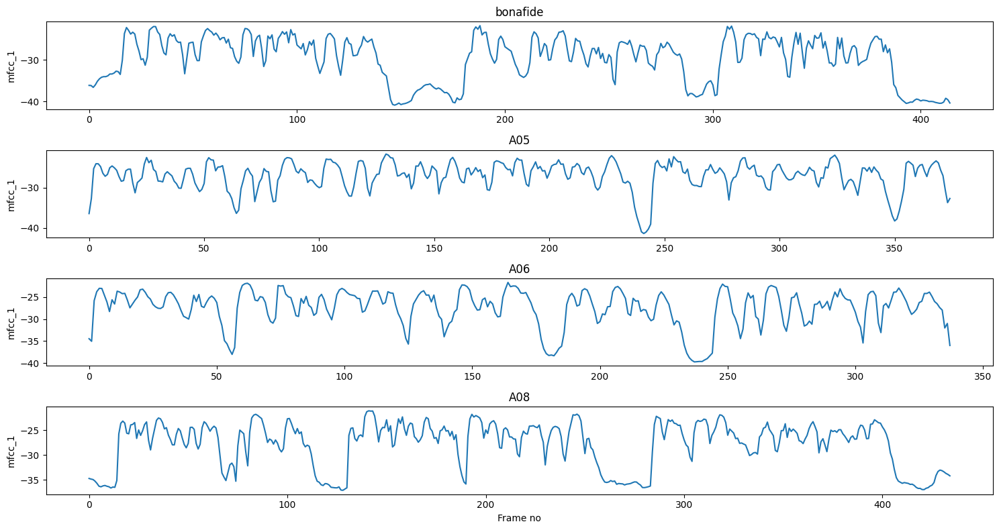


**Análise crítica:  viés de duração.** Investigou-se se os modelos poderiam explorar um atalho conhecido do ASVspoof: a diferença de **duração** entre as classes. Os áudios spoof são sistematicamente mais curtos (mediana ~440 frames contra ~570 dos bonafide), e **apenas a duração** já separa as classes com **AUC ":" 0,79**. As implicações diferem por modelo: SVM e Gradient Boosting usam features agregadas, que **não codificam a duração**. A GRU recebe a sequência completa e **enxerga a duração**, podendo conter esse viés. Porém, a proporção de **silêncio**, por sua vez, mostrou-se menos discriminatória, indicando que características da fala são utilizadas.


### Adicional: Ataque adversarial a modelo de fala

Como atividade adicional, demonstrou-se um ataque adversarial *white-box* sobre o modelo de reconhecimento de fala **Wav2Vec2** (`facebook/wav2vec2-base-960h`).  
O ataque gerado foi o **PGD** em duas situações distintas:

- **Não direcionado:** altera a transcrição sem alvo definido. Perturbação quase imperceptível (SNR ~ 33dB).

- **Direcionado:** força-se um texto-alvo, o áudio limpo passou a ser transcrito como **"HELLO WORLD"**. Exige perturbação maior (SNR ~ 15 dB).

    Áudios para reprodução: [limpo](Outros/Aula%2003/audio_limpo.wav) <br>
    Transcricao do audio limpo: I HAD THAT CURIOSITY BESIDE ME AT THIS MOMENT <br>
    [não direcionado](Outros/Aula%2003/adv_nao_direcionado.wav) <br>
    Transcricao do audio (não direcionado): WHY HAVE THAT CURIOSITY BESIDE ME AT THIS MULLET <br>  
    [direcionado](Outros/Aula%2003/adv_direcionado.wav) <br>
    Transcricao do audio (direcionado): HELLO WORLD <br>
   
Notebook: .


### Aula 04 – nanoGCG
Contexto: 
- Análise estática e dinâmica no notebook fornecido para compreensão do funcionamento da biblioteca nanoGCG. Resultados disponíveis em: 
- Realização de novos experimentos com outro modelo-alvo (Qwen/Qwen2-1.5B-Instruct) avaliando se a inclusão do sufixo adversarial faz os ataques terem mais sucesso.
- Os parâmetros de configuração do nanogcg são:
    num_steps= [100, 200 ou 300] 
    search_width=64, 
    topk=64,
    seed=42,
    verbosity="WARNING"

- A avaliação dos ataques é realizado por humano.

Resultados:
Nos experimentos realizados o sufixo adversarial permitiu o modelo fornecer informações censuradas pelo alinhamento de segurança em diferentes tipos de tarefas maliciosas.
Os ataques gerados, tanto em pt-BR e en-US, foram bem sucedidos, ou seja, não houve nenhuma recusa do modelo em tratar de tais assuntos. Obviamente, faz parte do escopo deste trabalho avaliar a veracidade das respostas.

Alguns exemplos são:


Notebook: .


